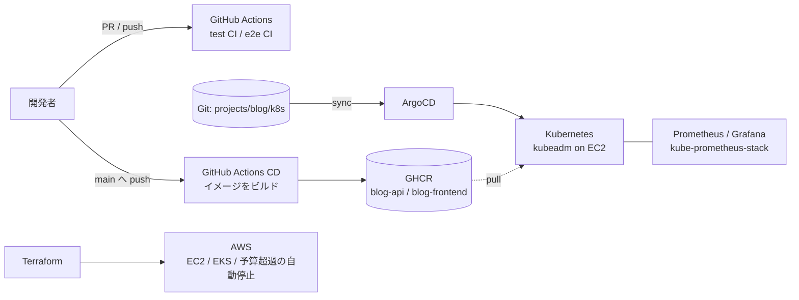

# Portfolio 2026-2027

Platform Engineer / SRE を目指して、ブログAPIを題材に、
「作る → 載せる → 自動でデプロイする → 運用する」を自分で一通り組んだ記録です。
インフラ(Terraform / Kubernetes / CI/CD)が主役です。

## 🗺️ 全体像

## 🧰 技術スタック

| 分野 | 使ったもの |
|---|---|
| アプリ | TypeScript, Fastify + Prisma + PostgreSQL(API) / Next.js + React + Tailwind(フロント) |
| テスト | Vitest(API), Playwright(E2E) |
| コンテナ / オーケストレーション | Docker, Kubernetes(kubeadm), Helm |
| CI/CD | GitHub Actions, GHCR, ArgoCD |
| IaC / クラウド | Terraform(S3バックエンド), AWS(EC2, EKS, Budgets, SNS, Lambda) |
| 監視 | Prometheus, Grafana(kube-prometheus-stack) |

## 📂 プロジェクト

### 1. BlogAPI ― 自作アプリをKubernetesで運用する(`projects/blog`)
- **何を**: Fastify + Prisma + PostgreSQL のAPIと、Next.js のフロントを作り、自前kubeadmクラスタで動かした
- **なぜ**: インフラを学ぶ「載せる対象」を、自分で一から作ったアプリにするため
- **学んだこと**: CIは毎回まっさらな環境で始まるため、ローカルでは隠れていた依存(prisma generate、node_modules など)が全部表に出る

### 2. 自前kubeadmクラスタ(AWS EC2 2台)
- **何を**: コントロールプレーンとワーカーを自分で構築し、Calico、ArgoCD、BlogAPIを載せた
- **なぜ**: EKSの固定費(月$73)が予算に合わず、また、コントロールプレーンの中身を自分の手で理解したかったため
- **学んだこと**: 「DNSが引けない」障害の原因は、SGでIPIP(プロトコル4)が未許可だったことだった。BGP(経路情報)とIPIP(実データ)は別レイヤー。DNSの問題に見えても、まず下位の到達性から疑う

### 3. CI/CD(`.github/workflows`)
- **何を**: Vitest と Playwright E2E をPRで実行。mainへのpushで、amd64イメージをGHCRへbuild & push
- **なぜ**: テストは変更の確認用、pushは本番に使うイメージを作る用で、動かすタイミングが違うためCIとCDを分けた
- **学んだこと**: Macでビルドしたarm64イメージは、amd64ノードで ImagePullBackOff になる。ビルドの対象は、本番で動くアーキテクチャに合わせる
- **今後の改善**: イメージタグが `latest` 固定。SHAタグ化して、ArgoCDが新しいイメージに追従できるようにする

### 4. ArgoCD(GitOps)
- **何を**: Gitを正として、Helmチャートをdev/prodに同期
- **学んだこと**: ArgoCDはGitにないリソースを作れないので、ConfigMap/Secretも含めて全部Git管理にする必要がある。Applicationが `Unknown` のとき、CRDの登録漏れまで疑って切り分けた

### 5. Terraform + AWS(`platform-engineering/projects/terraform`, `ec2-basics`, `eks-basics`)
- **何を**: S3バックエンド(ロック、バージョニング)、VPC/EC2、Budgets、EKS(作ってBlogAPIを流し、同日中にdestroy)
- **学んだこと**: planは「コード・state・実体」の比較。stateを置くバケットだけは、Terraform外で作る。EKSは、namespaceとPVを先に消さないと、Kubernetesが作ったAWSリソースが残る

### 6. 予算超過でEC2を自動停止(`platform-engineering/projects/auto-stop`)
- **何を**: Budgets → SNS → Lambda → EC2停止(タグ `AutoStop=true` のものだけ)
- **学んだこと**: 入口(誰がLambdaを呼ぶか)は `aws_lambda_permission`、出口(Lambdaが何を呼ぶか)は実行ロール。IAMの条件は、止められる範囲の上限になる

### 7. 監視(`platform-engineering/projects/monitoring`)
- **何を**: kube-prometheus-stack をHelmで導入し、Grafanaで可視化
- **学んだこと**: Prometheusは収集と保存、Grafanaは可視化。node-exporter(ノードの情報)と kube-state-metrics(リソースの状態)は別物

## 📚 学習の進め方

Issueを立てる → 解説 → 手を動かす → 理解テスト → Issueをクローズ、の1サイクルで進めています。
目的は「作ること」ではなく「理解すること」です。

- 学習ログ: [`docs/learning-logs/`](docs/learning-logs/)
- 理解テストの結果と弱点: [`review/`](review/)

## 🗂️ ディレクトリ構成

| パス | 内容 |
|---|---|
| `projects/blog/` | BlogAPI(api / frontend / k8s) |
| `platform-engineering/` | インフラ周りのプロジェクト(Terraform、ArgoCD、監視、自動停止など) |
| `review/` | 理解テストの結果とトピック |
| `docs/` | 学習ログ |
| `archive/` | 基礎学習の旧プロジェクト(React、TypeScript) |
| `exercises/` | 演習の置き場(今後追加) |
| `scripts/` | クラスタの起動・停止スクリプト |
